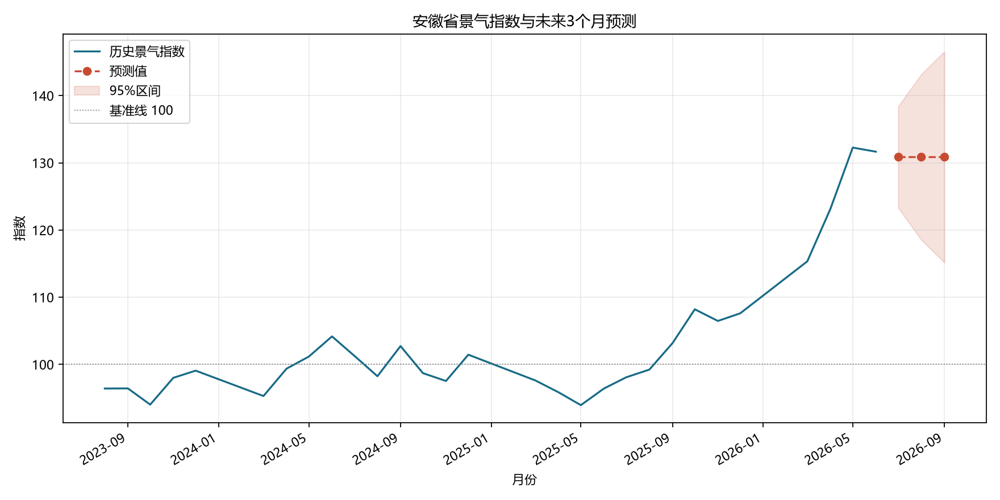

# 安徽省月度生产与投资景气指数

应用统计展示项目。使用[国家统计局“国家数据”平台](https://data.stats.gov.cn/)的安徽省分省月度指标，整理五项变量，构建主成分分析（PCA）景气指数，并用季节性 ARIMA 与季节朴素方法进行短期预测和滚动验证。

## 从哪里开始看

1. [PDF 分析报告](安徽省月度景气指数项目/outputs/安徽省月度景气指数分析报告.pdf)：适合先了解问题、方法、图表和局限。
2. [核心分析结果 Excel](安徽省月度景气指数项目/outputs/安徽省月度景气指数分析结果.xlsx)：查看按月份排列的五项变量、指数、预测和验证结果。
3. [完整项目与复现说明](安徽省月度景气指数项目/README.md)：查看代码、数据口径、运行步骤和测试。
4. [精简版交付目录](安徽省月度景气指数项目_精简版/README_先看这里.md)：用于离线展示。

数据范围为 2023 年 8 月至 2026 年 7 月。36 个月中，五项核心指标齐全的月份有 29 个。由于没有任何一个自然年具备 12 个完整月份，指数使用 2024 年 10 个有效月份的均值作为基准 100。预测仅适合作为方法展示和短期参考。

项目没有自动抓取国家统计局网站；原始 Excel 和指标映射保存在完整项目的 `data/raw/` 与 `data/metadata/raw_file_manifest.csv` 中。
